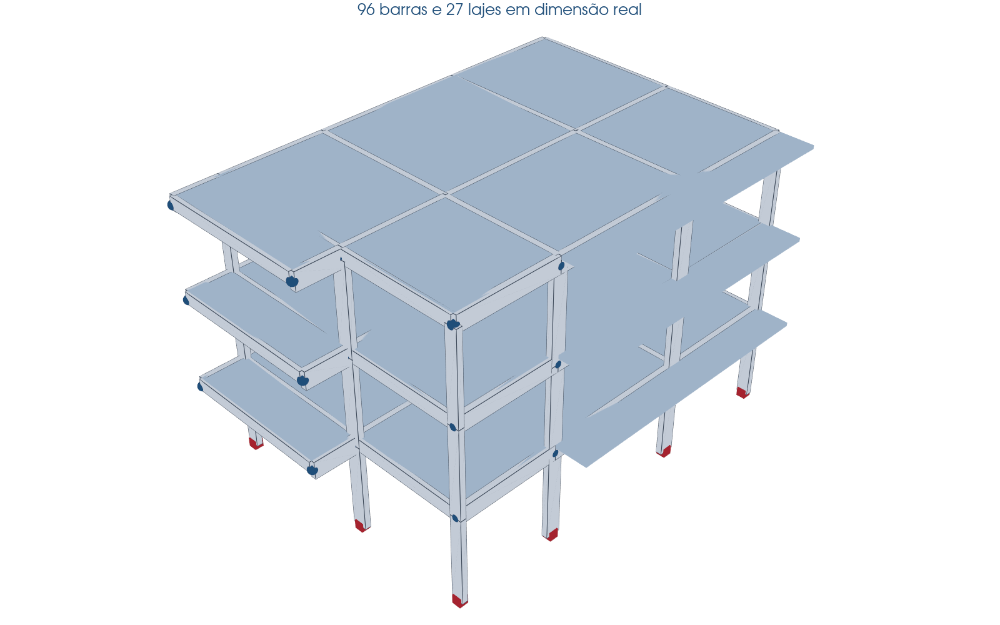
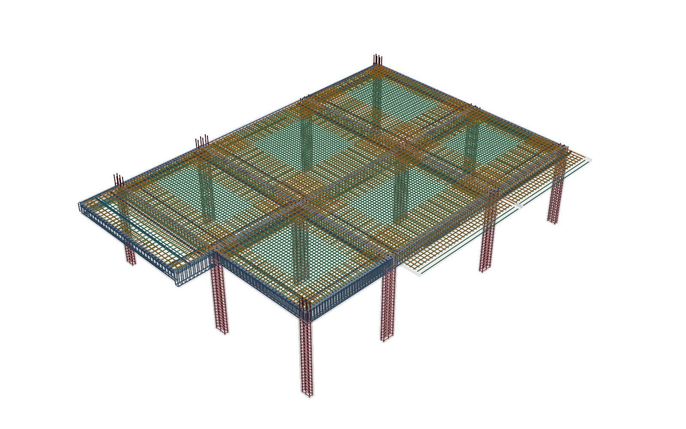
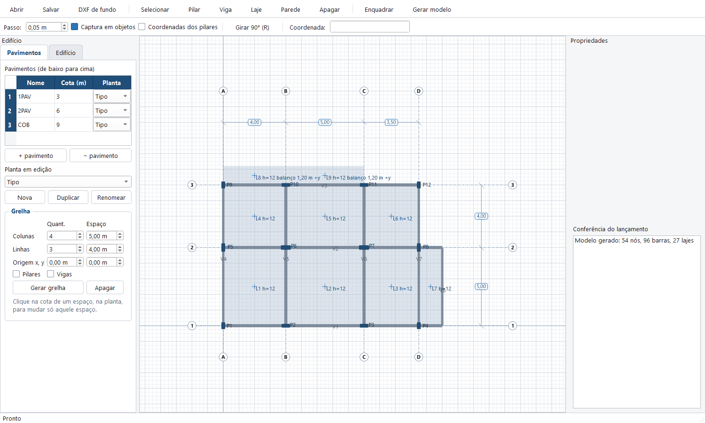
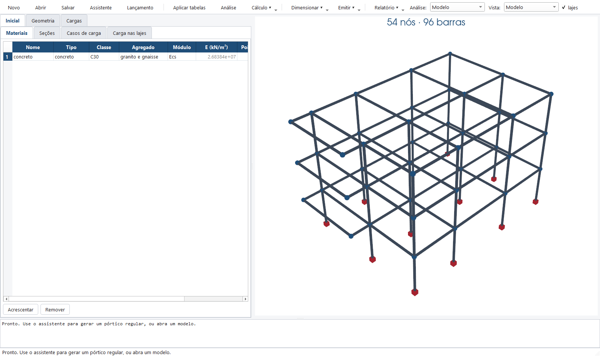
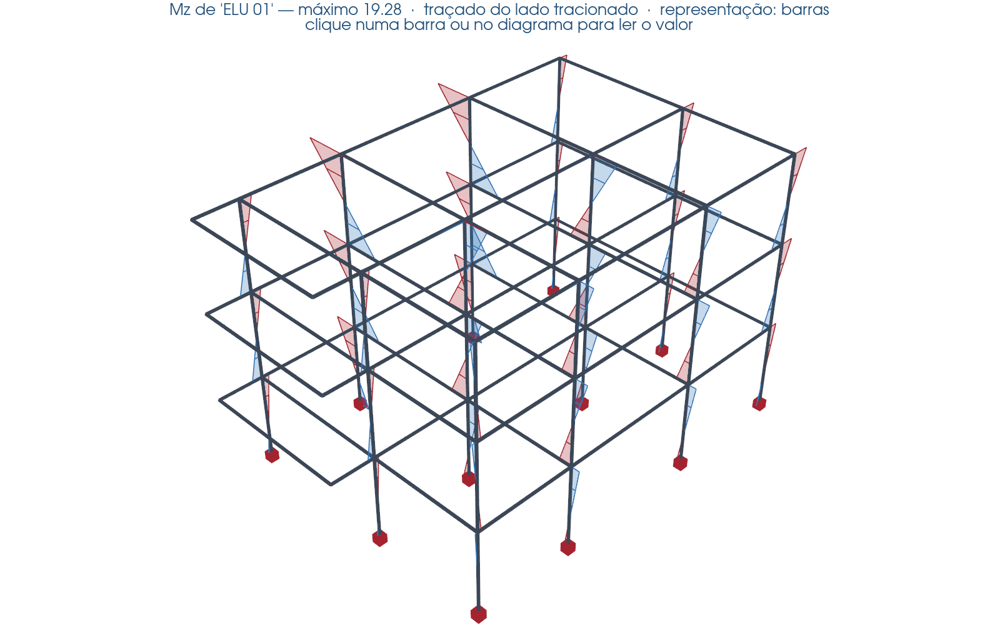
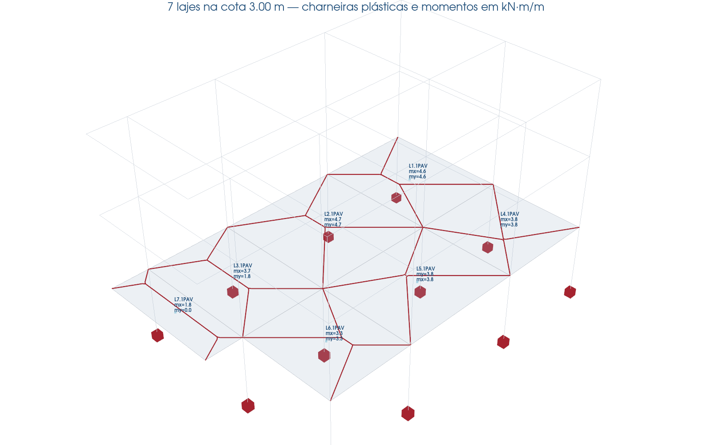
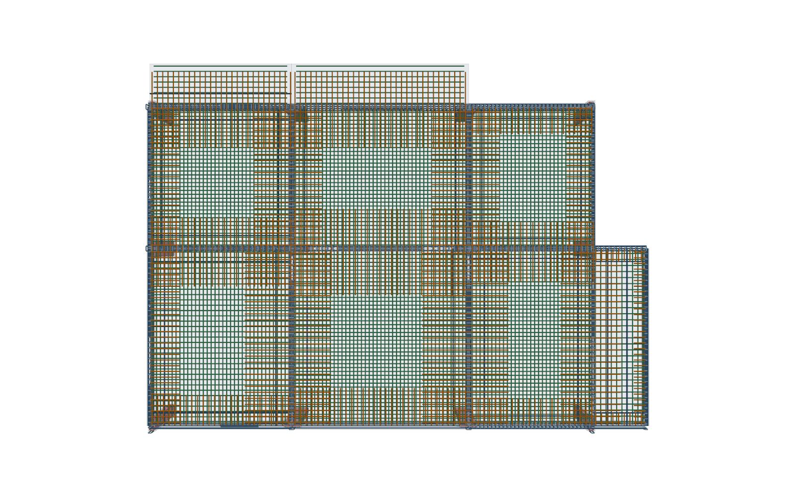

# Pórticos 3D — análise de pórticos espaciais e dimensionamento de edifícios (NBR 6118)

Programa de mesa para Windows, em Python/PySide6, que **resolve o pórtico
espacial de um edifício de concreto armado e dimensiona as peças dele**. O
usuário lança o edifício por planta de pavimento — pilares, vigas, lajes,
paredes e a grelha de eixos — ou monta o modelo de barras direto em tabelas.
O programa gera o modelo de cálculo e as combinações da NBR 6118. Resolve em
1ª e 2ª ordem, com estabilidade global, flambagem e análise modal, e passa os
esforços aos motores dos programas de **Pilares**, **Vigas** e **Lajes** da
casa. Termina em armadura detalhada, desenhada em 3D, numa memória de cálculo
em Word, no quadro de quantidades em Excel e nas pranchas em DXF.

Revisão corrente: **R03**.



---

## Sumário

1. [O que é](#o-que-é)
2. [Para que serve](#para-que-serve)
3. [O que o programa calcula](#o-que-o-programa-calcula)
4. [Como funciona](#como-funciona)
5. [Metodologia](#metodologia)
6. [Validação](#validação)
7. [Como usar](#como-usar)
8. [Saídas](#saídas)
9. [Organização do repositório](#organização-do-repositório)
10. [Histórico](#histórico)
11. [Limites de escopo](#limites-de-escopo)
12. [Referências](#referências)
13. [Responsabilidade técnica](#responsabilidade-técnica)

---

## O que é

Um solver matricial de pórticos espaciais (método da rigidez direta, elemento
de dois nós e doze graus de liberdade, de Euler-Bernoulli ou de Timoshenko),
na formulação de McGuire, Gallagher e Ziemian — *Matrix Structural
Analysis*, o livro por trás do MASTAN2 —, acoplado aos programas de elemento
da casa:

| Elemento | Norma | Motor copiado de |
|---|---|---|
| Pilares | ABNT NBR 6118:2026 | **Pilares em Concreto Armado**, tag `motor-2026-11-25` |
| Vigas contínuas | ABNT NBR 6118:2026 | **Dimensionador de Vigas**, tag `motor-2026-11-25` |
| Lajes maciças, em balanço e treliçadas | ABNT NBR 6118:2026 | **Lajes de Concreto Armado**, revisão R13 |
| Vento | ABNT NBR 6123:2023 | **NBR-6123** (cálculo de S2 e das forças) |

Nenhum dimensionamento de peça é reescrito aqui. Os motores são **cópias
fiéis** (vendorizadas, não importadas) dos programas de origem, conferidas
byte a byte pelo autoteste. O que este programa acrescenta é o que só existe
no nível do edifício:

- o **modelo do pórtico** e a análise global (1ª e 2ª ordem, γz, flambagem,
  modal, diafragma rígido, laje em grelha);
- o **lançamento por planta**, que gera o modelo de barras;
- a **ponte** de cada peça para o motor dela: o lance do pilar com os
  esforços concomitantes, a viga contínua com a envoltória do pórtico e a
  mesa colaborante, o pavimento de lajes com as continuidades;
- a **compatibilização** entre as peças (emendas de pilar, nós viga–pilar)
  e a armadura do pavimento inteiro em 3D.

## Para que serve

- **Projeto de edifícios de concreto armado** de pequeno e médio porte: do
  lançamento ao detalhamento, sem copiar esforço de um programa para outro.
- **Estabilidade global**: γz e α por combinação, classificação de nós fixos
  e móveis, P-Δ e a 2ª ordem global levada ao dimensionamento (15.7).
- **Conferir um modelo**: o mesmo modelo resolvido aqui, no MASTAN2, no
  PyNiteFEA e no OpenSeesPy dá os mesmos números (ver Validação).
- **Análise modal** de edifícios e passarelas, com massa adicional por caso
  de carga.
- **Ver a armadura do edifício**: a do pavimento inteiro, de pilares, vigas e
  lajes, no lugar, em 3D.

## O que o programa calcula

**Análise do pórtico** (`portico3d/core`)

- Rigidez direta com trechos rígidos nas pontas, liberações, apoios elásticos
  (molas) e recalques; cargas nodais, distribuídas uniformes, trapezoidais e
  parciais, peso próprio.
- Combinações últimas e de serviço da NBR 6118 (Tabelas 11.1 a 11.4), com
  grupos excludentes, desaprumo global (11.3.3.4.1) e a regra dos 30 % entre
  vento e desaprumo; vento da NBR 6123 nas quatro direções.
- Envoltória com os esforços **concomitantes** de cada combinação.
- 2ª ordem: matriz geométrica consistente, P-Δ iterativo, carga crítica e
  modos de flambagem, γz (15.5.3) e α (15.5.2), rigidez secante (15.7.3).
- Análise modal (frequências, modos, massa participante), também com massa de
  casos de carga.
- Laje como **carga** (áreas a 45°), como **diafragma rígido** ou como
  **grelha** de barras; matriz esparsa para modelos grandes.

**Dimensionamento** (pelas pontes, com os motores copiados)

- **Pilares**: um lance por pavimento, cada combinação governante com os
  esforços concomitantes de topo e base; flexão composta oblíqua, efeitos
  locais de 2ª ordem, armadura e estribos pelo programa de Pilares.
- **Vigas contínuas**: detectadas pela colinearidade das barras, com apoio em
  pilar (mola com a rigidez dos lances), em outra viga (carga indireta e
  suspensão) e balanços; seção T pela mesa colaborante (14.6.2.2, também a de
  laje em balanço); armadas pela envoltória do pórtico, pela viga contínua ou
  pela pior das duas.
- **Lajes**: pavimento por cota, com vãos livres, continuidades e
  compatibilização das negativas pelo programa de Lajes; laje treliçada por
  faixa; laje em balanço engastada na laje interna.
- **Compatibilização**: emendas por traspasse nas mudanças de seção do pilar
  (9.5.2.3, 17.3.5.3.2), nós viga–pilar (21.4) e nó de joelho na cobertura.

**Lançamento por planta** (`portico3d/lancamento`, `portico3d/ui/editor_planta.py`)

- Pavimentos e plantas-tipo; pilares (seção, giro, ponto de inserção),
  vigas por polilinha (uma viga por trecho reto), lajes por um ponto no
  contorno, laje em balanço, paredes sobre viga.
- O gerador quebra as vigas nos cruzamentos e pilares, decide os apoios,
  põe os trechos rígidos (14.6.2.1), acha o contorno das lajes e as cargas.
- Editor com grade, captura, coordenada digitada, grelha de eixos (cota de
  espaçamento editável), seleção múltipla e DXF de fundo.

## Como funciona

```
Lançamento por planta  ──(gerador)──►  modelo de barras  ◄──  tabelas
                                              │
                                              ▼
              combinações NBR 6118 (γ, ψ, desaprumo, vento NBR 6123)
                                              │
                    1ª ordem ── γz / α ── P-Δ ── flambagem ── modal
                                              │
                         envoltória com esforços concomitantes
                                              │
          ┌───────────────────────────────────┼───────────────────────────┐
          ▼                                   ▼                           ▼
   lances de pilar                     vigas contínuas              pavimentos de laje
   (motor de Pilares)              (motor de Vigas; seção T,      (motor de Lajes;
                                    molas, apoio em viga)           continuidades)
          └───────────────────────────────────┼───────────────────────────┘
                                              ▼
              compatibilização (emendas, nós) ── armadura do pavimento em 3D
                                              │
                 memória (.docx) ── quantitativos (.xlsx) ── pranchas (.dxf)
```

O núcleo (`portico3d/core`) não importa nada da interface. Dá para usá-lo
como biblioteca:

```python
from portico3d import Modelo, Secao, resolver

m = Modelo("exemplo")
m.add_material("aco", 210e6, 0.3)
m.add_secao(Secao.retangular("S", 0.20, 0.50))
m.add_no("A", 0.0, 0.0, 0.0)
m.add_no("B", 6.0, 0.0, 0.0)
m.add_barra("V1", "A", "B", "aco", "S")
m.apoiar("A")
caso = m.add_caso("G")
caso.distribuida("V1", qz=-20.0)
r = resolver(m, "G")
```

## Metodologia

O detalhe de cada decisão, com o porquê e a conferência que a trava, está no
`LEIAME.md` (notas técnicas, por assunto). Em resumo:

### O pórtico

- **Elemento**: 12 GDL, Euler-Bernoulli ou Timoshenko (com área de
  cisalhamento), trechos rígidos `offset_i/offset_j` e liberações por
  condensação estática.
- **Estabilidade**: a matriz é fatorada por Cholesky com conferência de pivô;
  mecanismo para com erro, nomeando os graus de liberdade soltos.
- **2ª ordem**: matriz geométrica consistente (Hermite), refinada por
  subdivisão interna (Guyan) — a viga-coluna fica a −0,0007 % da solução
  fechada com uma barra por lance. Os esforços saem de `(Ke + Kg)·D`.
- **Combinações**: cada combinação é resolvida por si quando há 2ª ordem
  (a superposição não vale com P-Δ).
- **Convenções**: Z vertical; os sinais e eixos estão em `LEIAME.md`
  ("Eixos e convenções de sinal").

### A laje no modelo

| Opção | O que faz |
|---|---|
| Carga (padrão) | a laje reparte o peso às vigas pelas áreas a 45° (triângulos e trapézios); a em balanço entrega tudo à viga do lado apoiado |
| Diafragma rígido | os nós de cada pavimento se movem como corpo rígido no plano (`D = D₀ + T·r`) |
| Grelha | a laje vira grelha de barras (Hambly), com faixas de borda; as vigas são partidas nos cruzamentos |

### As pontes de dimensionamento

- **Pilar**: o lance recebe, de cada combinação que governa uma ponta, o trio
  (N, Mx, My) concomitante no topo e na base, na convenção de face
  tracionada do programa de Pilares.
- **Viga**: a cadeia de barras colineares vira a viga contínua do programa de
  Vigas, com as cargas do pórtico, o pilar de cada apoio descrito para a
  solidariedade viga-pilar do 14.6.6.1 (larguras e lances acima e abaixo),
  apoio em outra viga pelo 18.3.6 e seção T, ou L na viga de borda. A envoltória do
  motor é trocada pela do pórtico **por fora** (a cópia não é editada), com
  o arredondamento sobre o apoio desligado, porque o pórtico já traz o
  trecho rígido.
- **Laje**: o pavimento vai inteiro, em vãos livres, com a largura de cada
  apoio pela face; o programa de Lajes detecta as continuidades e
  compatibiliza as negativas.
- **2ª ordem global no dimensionamento**: γz ≤ 1,10, 1ª ordem; γz ≤ 1,30 (com
  quatro andares ou mais), majoração por 0,95·γz; acima disso, P-Δ com a
  rigidez secante.

## Validação

### O autoteste

`py main.py --autoteste <pasta>` roda **751 conferências** e o autoteste da
janela, sem abrir nada na tela (cerca de 3 minutos). O motor de Pilares é a parte lenta; os
lances vão em paralelo (um processo por núcleo) e cada resultado de motor
fica guardado na sessão pela impressão da entrada, de modo que a armadura 3D
e o projeto completo não redimensionam o que o "Dimensionar" já fez. Cada valor esperado é uma solução fechada, uma condição de
equilíbrio, uma invariância ou o resultado de outro programa — nunca o
próprio programa contra ele mesmo:

- soluções fechadas da Resistência dos Materiais (barra axial, torção,
  balanço nos dois planos, biengastada, balanço em L, trechos rígidos, molas,
  recalques, cortante de Timoshenko);
- equilíbrio global e por barra, dM/dx = V, invariância sob rotação;
- Euler nos quatro casos de vinculação, viga-coluna exata, γz contra P-Δ;
- os valores das Tabelas 11.1 a 11.4, o desaprumo, a regra dos 30 %, o
  módulo do concreto (8.2.8) e a rigidez secante (15.7.3);
- a grelha contra a placa de Navier, o diafragma contra o OpenSeesPy;
- as pontes, a compatibilização, o lançamento, o editor (com cliques de
  mouse de verdade) e a armadura em 3D (nenhuma barra fora do concreto).

### Contra outros programas

| Referência | Resultado |
|---|---|
| **MASTAN2**: oito modelos, edifício de 68 nós e 112 barras | deslocamentos, reações e esforços iguais a 10⁻¹³ relativo |
| **PyNiteFEA**: dez cenários (vigas, balanço, pórtico, grelha, seção girada, Euler, mola, trecho rígido, pórtico espacial) | coincidência com o PyNite e com a solução fechada |
| **OpenSeesPy** (processo separado em Python 3.12): pórticos, diafragma rígido, modal de edifícios | mesmos números; pareamento de modos por MAC |
| Passarela do DNIT, TCC de Lima (UnB), TCC do edifício de Nascimento, dissertação de identificação modal, TCC do prédio com NDV | frequências e modos confrontados, com as divergências das fontes documentadas no `LEIAME.md` |

### Contra os programas de elemento rodados isoladamente

`exemplos/edificio_3pav.py` é um edifício de 3 pavimentos com vãos
variados, cinco seções de viga, vigas em balanço com sacada, lajes em balanço
e pilares girados. `exemplos/verificar_contra_programas.py` o dimensiona pelo
Pórticos e pelos programas **originais** (das pastas deles), com a entrada
montada à mão:

| | Resultado |
|---|---|
| Vigas (24 cadeias) | a viga que o Pórticos monta, aberta no programa de Vigas, dá resultado **idêntico** (momentos, regiões e cada posição de armadura); seções T, apoios e molas montados à mão batem exatamente |
| Pilares (214 verificações) | mesmo Nd, mesmos momentos de topo e base e **mesmo arranjo** em todas, contra o programa de Pilares no commit da cópia |
| Lajes (3 pavimentos) | posições, vínculos e veredito idênticos em todas, inclusive nas duas lajes em balanço lado a lado |
| Armadura 3D | nenhum ponto de barra fora do concreto |

O relatório, as entradas no formato de cada programa e as imagens ficam em
`exemplos/verificacao-3pav/`.



## Como usar

### Requisitos

- Windows 10 ou 11.
- Para o executável: nada além dele.
- Para rodar do código-fonte: Python 3.14 (ou 3.11+) e as dependências de
  `requirements.txt` (numpy, scipy, PySide6, pyvista, pyvistaqt,
  python-docx, openpyxl, ezdxf; pynite só para o autoteste). O OpenSeesPy é
  opcional: as conferências contra ele rodam num Python 3.12 separado
  (`py -3.12 -m pip install openseespy numpy`) e são puladas com aviso se ele
  não existir.

### Executável

O `construir.py` gera em `Exe atual/` a versão em pasta (`Porticos.exe` com
`_internal/`) e a portátil (`Porticos-portatil.exe`, arquivo único). Por ter
centenas de MB, ele não fica neste repositório.

### A partir do código-fonte

```bash
pip install -r requirements.txt
python main.py
```

No Windows também dá para abrir pelo `Iniciar_Porticos.bat`.

| Comando | Efeito |
|---|---|
| `python main.py` | abre a janela |
| `python main.py modelo.json --janela` | abre a janela com um modelo (de barras ou de lançamento) |
| `python main.py --autoteste [pasta]` | roda as conferências e o autoteste da janela |
| `python main.py modelo.json [caso]` | resolve um caso e imprime o resumo |
| `python main.py modelo.json --envoltoria` | gera as combinações, resolve e imprime a envoltória |
| `python main.py modelo.json --estabilidade` | γz por combinação, nós fixos ou móveis, flambagem |

### Fluxo de trabalho

1. **Lançamento** (Ctrl+L): o editor de planta. Pavimentos à esquerda (cota e
   planta de cada um, plantas-tipo, grelha de eixos), a planta no centro,
   propriedades do elemento à direita. Ferramentas Pilar, Viga, Laje, Parede;
   Ctrl+clique e Alt+clique montam a seleção; R gira o pilar. **Gerar
   modelo** (F9) entrega o modelo de barras à janela principal.

   

2. **Tabelas** (alternativa ao lançamento): materiais, seções, nós, barras,
   apoios, molas, lajes, casos e cargas, em três abas. O **Assistente** monta
   um pórtico regular.

   

3. **Análise** e **Cálculo**: 1ª e 2ª ordem, combinações, estabilidade,
   flambagem e modal; as opções de laje (carga, diafragma, grelha), a mesa
   colaborante e com que esforços as vigas são armadas.

   

4. **Dimensionar**: pilares, vigas, lajes e a compatibilização; cada peça com
   o veredito, os avisos e o relatório do motor de origem.

   

5. **Vista Armadura**: a armadura do pavimento escolhido, em 3D interativo.
6. **Emitir**: o projeto completo (memória, quantitativos, pranchas) ou cada
   saída avulsa.

## Saídas

| Arquivo | Conteúdo |
|---|---|
| `memória de cálculo.docx` | metodologia, modelo, esforços, estabilidade global, reações, pilares, vigas, confronto com a envoltória, lajes e quantitativos |
| `quadro de quantidades.xlsx` | resumo, quantidades por tipo de peça, aço por bitola e o veredito peça a peça |
| `desenhos.dxf` | prancha com todas as peças detalhadas, por tipo, e o quadro de quantidades |
| armadura em DXF | a armadura do pavimento em 3D, uma polilinha por barra, com a fôrma |
| modelo `.json` | o modelo de barras ou o lançamento, para reabrir |



## Organização do repositório

```
main.py                     janela, autoteste e linha de comando
construir.py                build, verificação e publicação em ../Exe atual
Porticos.spec               receita do PyInstaller
criar_icone.py              ícone do executável
requirements.txt            dependências
Iniciar_Porticos.bat        abre o programa a partir do código-fonte
README.md                   este documento
LEIAME.md                   notas técnicas, por assunto
LEIAME-DISTRIBUICAO.md      instruções que acompanham o executável
docs/                       imagens do README
exemplos/                   modelos, lançamentos e os confrontos com trabalhos publicados
  edificio_3pav.py          o edifício da verificação contra os programas isolados
  verificar_contra_programas.py
  verificacao-3pav/         relatório, entradas de cada programa e imagens
portico3d/
  core/                     o solver: modelo, elemento, montagem, 2ª ordem,
                            dinâmica, combinações (NBR 6118), envoltória,
                            lajes, diafragma, grelha, vento, MASTAN
  lancamento/               lançamento por planta: modelo, gerador, grelha, arquivo
  elementos/                motores copiados: pilares/, vigas/, lajes/, vento/
  dimensionamento.py        as pontes com os motores de elemento
  continuidade.py           vigas contínuas e apoio de viga em viga
  compatibilizacao.py       emendas de pilar e nós viga–pilar
  armadura3d.py             a armadura do pavimento no espaço
  armadura_dxf.py           a armadura em DXF 3D
  projeto.py                o projeto completo (memória, quantitativos, pranchas)
  saidas/                   memória, quantitativos e desenho único
  validacao.py              as conferências do autoteste
  ui/                       janela, tabelas, vista 3D, editor de planta, assistente
```

Na máquina do autor, o repositório é a pasta `Programa/`, ao lado de duas
pastas que ficam fora do git, como nos outros programas da casa:

```
Pórticos 3D/
  Programa/     este repositório
  Fontes/       livros, modelos do MASTAN2 e referências (direitos de terceiros)
  Exe atual/    o executável publicado pelo construir.py
```

Também não são versionados (`.gitignore`): as pastas de build, as saídas do
autoteste e os temporários do Python e do Office.

## Histórico

| Data | Marco |
|---|---|
| 03/09/2026 | **R01**: solver matricial de pórticos espaciais (rigidez direta, Euler-Bernoulli e Timoshenko), combinações da NBR 6118, envoltória, 2ª ordem, flambagem e γz; janela PySide6; 277 conferências |
| 09/09/2026 | **R02**: pontes com os programas de Pilares, Vigas e Lajes; memória de cálculo, quadro de quantidades e pranchas DXF; executável; 421 conferências |
| 30/09/2026 | Motor de desenho passa a PyVista/VTK; armadura em 3D |
| 01–02/10/2026 | Bateria contra o PyNiteFEA, OpenSeesPy entre processos, análise modal de edifícios com MAC, massa adicional, passarela do DNIT, TCCs de Lima e Nascimento |
| 16/10/2026 | Diafragma rígido, laje em grelha, matriz esparsa, vigas armadas pelo pórtico; 2ª ordem global no dimensionamento, viga T, laje treliçada, continuidade de pilares e nós; lançamento por planta (gerador e editor); dissertação e TCC com NDV contra a modal |
| 19/10/2026 | Editor: zoom no ponto do mouse, uma viga por direção, grelha de eixos com cota editável, seleção múltipla |
| 03/11/2026 | Motores Vigas R04 e Pilares R05; ancoragem da negativa de extremidade no nó monolítico |
| 05/11/2026 | **R03**: laje em balanço; motores Pilares R05 (recopiado) e Lajes R11; edifício de 3 pavimentos conferido contra os programas isolados — corrigidos a largura do pilar girado, a largura de apoio das lajes por face, a mesa da viga de borda e o nivelamento dos topos no 3D; 740 conferências |
| 25/11/2026 | Repositório publicado; pasta reorganizada no padrão dos outros programas (`Programa/`, `Fontes/`, `Exe atual/`); R01, R02 e R03 como commits datados com tags; procedência dos motores pelo commit do repositório de origem |
| 25/11/2026 | Motor de Vigas recopiado (`motor-2026-11-25`): seção L na viga de borda, barra pela mínima cortada pelo diagrama, solidariedade viga-pilar do 14.6.6.1, apoio em outra viga pelo 18.3.6; corrigida a altura da viga apoiada passada ao motor (ia em cm × 100) |
| 25/11/2026 | Cache e paralelismo dos motores: no edifício de 3 pavimentos o fluxo pilares + vigas + lajes + armadura 3D dos três pavimentos caiu de 33 min para 4 min, com resultado idêntico |
| 25/11/2026 | Motor de Pilares recopiado (`motor-2026-11-25`, 1,6 a 20 vezes mais rápido, resultado idêntico bit a bit no programa de Pilares); os 214 arranjos do edifício de 3 pavimentos não mudaram. Autoteste de 18 para 2,5 min; verificação contra os programas isolados de 23 para 2 min |
| 25/11/2026 | Motor de Lajes recopiado (R13): negativa da borda comum no eixo da viga, balanço pelos vínculos, sacadas vizinhas sem engaste lateral (R12) e ancoragem no apoio pelo 18.3.2.4 (R13); a laje em balanço entra com o bordo do lado apoiado "apoiado"; lajes do edifício de 3 pavimentos idênticas às do programa isolado |
| 25/11/2026 | **R04**: os três motores de elemento recopiados de commits e confrontados com eles (Vigas e Pilares `motor-2026-11-25`, Lajes R13); cache e paralelismo dos motores; edifício de 3 pavimentos idêntico aos programas isolados em pilares, lajes e na viga montada; 751 conferências em 2,5 min |

## Limites de escopo

- **Lançamento**: excentricidade viga–pilar, rebaixo, viga invertida, laje
  não retangular, abertura em laje e parede sobre laje ainda não são gerados
  (o gerador recusa com o motivo); não há mover, copiar ou desfazer.
- **Laje em balanço**: só maciça, e só engastada numa laje interna contínua.
  O solver não tem torque distribuído; o engaste na torção da viga de borda
  não é modelado, e a laje em balanço sem laje interna é recusada.
- **Lajes**: como carga, diafragma ou grelha de barras; a laje em casca
  (elemento de placa) é expansão futura, assim como pilar-parede e núcleo em
  casca.
- **Fundações**: as reações saem por apoio; a ponte com sapatas, blocos e
  estacas não existe.
- **Dinâmica**: análise modal; espectro de resposta (NBR 15421), análise no
  tempo e inelástica não são feitos.
- **Desenho**: as vigas de um pavimento são desenhadas com o topo nivelado
  (como na obra); o cálculo põe todos os eixos na cota do pavimento.
- **Motores copiados**: o que cada um não cobre, este programa também não
  cobre; ver o README de cada programa de origem.

## Referências

**Normas**

- ABNT. **NBR 6118:2026** — Projeto de estruturas de concreto. Combinações
  (Tabelas 11.1 a 11.4), desaprumo (11.3.3.4.1), módulo (8.2.8), estabilidade
  global (15.4, 15.5, 15.7), trechos rígidos (14.6.2.1), mesa colaborante
  (14.6.2.2), lajes (14.7), emendas (9.5.2), nós (21.4).
- ABNT. **NBR 6123:2023** — Forças devidas ao vento em edificações.
- ABNT. **NBR 8681** — Ações e segurança nas estruturas.
- ABNT. **NBR 6120** — Ações para o cálculo de estruturas de edificações.

**Livros e trabalhos**

- McGUIRE, W.; GALLAGHER, R. H.; ZIEMIAN, R. D. **Matrix Structural
  Analysis**. 2. ed. (a formulação do elemento e da 2ª ordem; o livro do
  MASTAN2).
- LOGAN, D. L. **A First Course in the Finite Element Method**.
- HAMBLY, E. C. **Bridge Deck Behaviour** (analogia de grelha).
- LIMA (TCC, UnB, 2019), NASCIMENTO (TCC, edifício), dissertação de
  identificação modal por métodos no domínio da frequência, TCC do edifício
  esbelto com NDV, e o modelo da passarela do DNIT: os confrontos da análise
  modal (`exemplos/`).

**Programas de referência**

- **MASTAN2** v3.3 — os oito modelos de aferição ficam em `Fontes/MASTAN`.
- **PyNiteFEA** e **OpenSeesPy** — motores de confronto no autoteste.

**Programas de origem dos motores**

- **Pilares em Concreto Armado** —
  [github.com/VictorHF-2/Pilares-em-Concreto-Armado-](https://github.com/VictorHF-2/Pilares-em-Concreto-Armado-).
- **Dimensionador de Vigas** —
  [github.com/VictorHF-2/Dimensionador-de-Vigas](https://github.com/VictorHF-2/Dimensionador-de-Vigas).
- **Lajes de Concreto Armado** —
  [github.com/VictorHF-2/Lajes-de-concreto-armado](https://github.com/VictorHF-2/Lajes-de-concreto-armado).
- **NBR-6123** — programa de vento da casa.

Os textos das normas, dos livros e dos trabalhos não são distribuídos neste
repositório. Ficam com o autor, fora do controle de versão.

---

## Responsabilidade técnica

Este programa é uma ferramenta de apoio ao projeto. Os resultados devem ser
conferidos por engenheiro habilitado, que responde pelo projeto. O autoteste
garante que o programa reproduz as referências acima. Ele não substitui o
julgamento sobre se o modelo representa a estrutura real.
